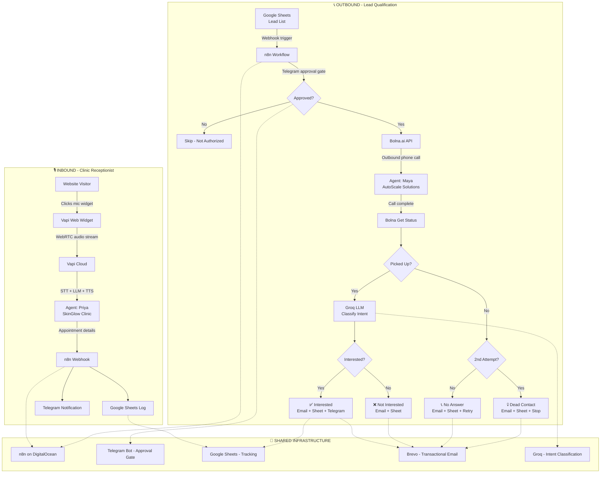
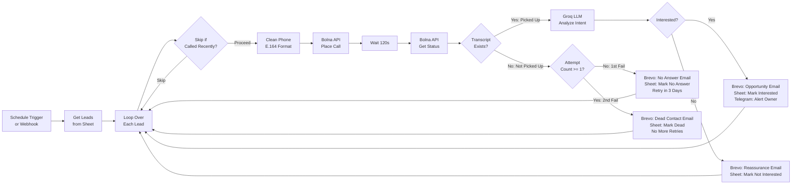

# AI Voice Agent - Dual-Mode Voice AI Showcase

A portfolio project demonstrating **two distinct voice AI capabilities** in a single system: an **inbound AI receptionist** (browser-based) and an **outbound lead qualification campaign** (telephony-based), powered by two different voice AI platforms, unified by n8n workflow automation.

🔗 **Live Showcase:** [voiceagent.autothynk.com](https://voiceagent.autothynk.com)

---

## What This Project Demonstrates

| Capability | Inbound Receptionist | Outbound Lead Qualifier |
|---|---|---|
| **Platform** | Vapi.ai (Web Widget) | Bolna.ai (Telephony) |
| **Agent Name** | Priya (SkinGlow Clinic) | Maya (AutoScale Solutions) |
| **Channel** | Browser-based voice chat | Outbound phone calls |
| **Use Case** | Answer questions, collect appointment details | Qualify leads, book discovery calls |
| **Trigger** | Visitor clicks mic on website | n8n workflow triggers campaign |
| **Cost Model** | ~$0.05/min (Vapi platform + STT/LLM/TTS) | ~$0.06/min (Bolna bundled rate) |

---

## Architecture

### System Overview



### Outbound Campaign - Detailed Node Flow



---

## Tech Stack

| Component | Technology | Role |
|---|---|---|
| Inbound Voice AI | [Vapi.ai](https://vapi.ai) | Browser-based voice widget, WebRTC |
| Outbound Voice AI | [Bolna.ai](https://bolna.ai) | Telephony API, outbound phone calls |
| Workflow Engine | [n8n](https://n8n.io) (self-hosted) | Orchestration, branching logic, API calls |
| LLM (Classification) | [Groq](https://groq.com) (LLama 3.3 70B) | Post-call transcript intent classification |
| Email | [Brevo](https://brevo.com) | Transactional follow-up emails (4 templates) |
| Data Store | Google Sheets | Lead tracking, call status, attempt counts |
| Notifications | Telegram Bot API | Owner alerts + demo approval gate |
| Hosting | DigitalOcean | n8n droplet |
| Showcase Page | GitHub Pages | Static landing page |

---

## Project Structure

```
ai-voice-agent/
├── README.md
├── index.html                              # Showcase landing page
├── prompts/
│   ├── inbound_receptionist.md             # Vapi agent: Priya (SkinGlow Clinic)
│   └── outbound_qualifier.md               # Bolna agent: Maya (AutoScale Solutions)
├── workflows/
│   ├── outbound_campaign_SANITIZED.json    # Production n8n workflow (credentials stripped)
│   ├── outbound_demo.json                  # Demo workflow skeleton (single-lead mode)
│   ├── inbound_webhook.json                # Inbound call data handler
│   └── telegram_gate.json                  # Telegram approval mechanism
└── docs/
    └── assets/                             # Screenshots, diagrams
```

---

## How It Works

### Inbound Flow (Vapi - Browser Voice)

1. Visitor lands on the clinic website and clicks the mic widget
2. Vapi opens a WebRTC audio stream to its cloud
3. The AI agent (Priya) greets the visitor and handles their query
4. If the visitor wants to book an appointment, Priya collects their details
5. Call data is sent via webhook to n8n
6. n8n logs the interaction to Google Sheets and sends a Telegram notification

### Outbound Flow (Bolna - Phone Calls)

1. A lead list sits in Google Sheets with names, phone numbers, and status
2. The n8n workflow is triggered (manually or via schedule)
3. **Telegram Gate:** A message is sent to the owner's Telegram asking for approval before any call is placed
4. On approval, the workflow loops through each lead:
   - Skips leads already called recently (3-day cooldown for No Answer)
   - Cleans the phone number to E.164 international format
   - Places an outbound call via Bolna's API
   - Waits 120 seconds for the call to complete
   - Polls Bolna for the call transcript and status
5. **If picked up:** Transcript is sent to Groq (LLama 3.3 70B) for intent classification
   - **Interested** -> Opportunity email + Google Sheets update + Telegram alert
   - **Not Interested** -> Reassurance email + Google Sheets update
6. **If not picked up:**
   - **1st failure** -> "We tried calling" email + mark for retry in 3 days
   - **2nd failure** -> "Door is open" final email + mark as Dead Contact

### Security: Telegram Approval Gate

Both demos are gated behind a Telegram approval mechanism. When triggered:
1. n8n sends a message to the owner's Telegram with call details
2. Owner replies "yes" to approve or "no" to block
3. Only approved calls proceed, preventing unauthorized credit burn

---

## Production Background

The outbound workflow architecture is based on a **production system** that made **5,000+ outbound calls** with an **~8% positive response rate** (~400 qualified leads) during a real client engagement. The production system used Airtable as the data store and ran daily scheduled campaigns.

For this portfolio showcase, the system has been adapted with:
- Google Sheets replacing Airtable (simpler setup, no paid plan needed)
- Telegram approval gate added (demo security)
- Both Vapi inbound and Bolna outbound unified in one project
- All credentials stripped and replaced with placeholders

---

## Setup Guide

### Prerequisites
- [Vapi.ai](https://vapi.ai) account (free tier: $10 credits)
- [Bolna.ai](https://bolna.ai) account (free tier: $5 credits)
- [n8n](https://n8n.io) instance (self-hosted or cloud)
- [Groq](https://groq.com) API key (free tier available)
- [Brevo](https://brevo.com) account (free tier: 300 emails/day)
- Telegram Bot (via [@BotFather](https://t.me/BotFather))
- Google Sheets API credentials

### Quick Start

1. **Clone this repo:**
   ```bash
   git clone https://github.com/utkarshkapoor95/ai-voice-agent.git
   ```

2. **Set up Vapi Agent:**
   - Create a new assistant in Vapi dashboard
   - Paste the prompt from `prompts/inbound_receptionist.md`
   - Configure voice and model settings
   - Copy the Assistant ID

3. **Set up Bolna Agent:**
   - Create a new agent in Bolna dashboard
   - Paste the prompt from `prompts/outbound_qualifier.md`
   - Configure voice provider and LLM
   - Copy the Agent ID

4. **Import n8n Workflows:**
   - Import `workflows/outbound_demo.json` into your n8n instance
   - Replace all `YOUR_*` placeholders with your actual credentials
   - Set up the Telegram gate with your bot token and chat ID

5. **Deploy Showcase Page:**
   - Push to GitHub
   - Enable GitHub Pages
   - Set up CNAME for `voiceagent.autothynk.com`

---

## Cost Analysis

| Component | Free Tier | Per-Minute Cost |
|---|---|---|
| Vapi.ai | $10 credits | ~$0.05/min (platform + Deepgram STT + GPT-4o + ElevenLabs TTS) |
| Bolna.ai | $5 credits | ~$0.06/min (bundled: platform + STT + LLM + TTS + telephony) |
| Groq | Free tier | Free (for classification - minimal tokens) |
| Brevo | 300 emails/day | Free |
| n8n | Self-hosted | $0 (runs on existing DigitalOcean droplet) |

**Estimated demo cost:** ~$0.30-0.50 per complete demo cycle (1 inbound + 1 outbound call)

---

## Author

**Utkarsh Kapoor**
- MBA @ ABV-IIITM Gwalior | AI Automation & Data Systems Builder
- [Portfolio](https://utkarshkapoor.com) | [LinkedIn](https://linkedin.com/in/utkarsh-kapoor-618256203) | [GitHub](https://github.com/utkarshkapoor95)

---

## License

This project is open-sourced for portfolio and educational purposes. The workflow architecture and prompts are original work. Feel free to use as reference for your own voice AI projects.
